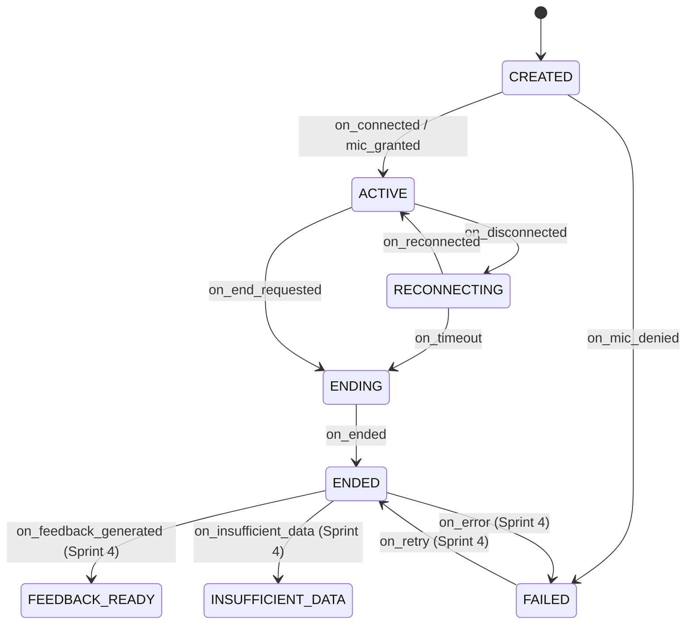

# Sprint 3: AI Coach Voice Conversation — Learning & Architectural Notes

## 1. Tổng quan & Mục tiêu Sprint 3
Trong Sprint 3, TalkWithMe xây dựng trải nghiệm luyện nói 1-1 với AI Coach theo triết lý **Communication-First**:
- Tăng thời lượng người học thực sự nói, không ngắt lời khi người học ngập ngừng hoặc sử dụng từ đệm (*um, uh, like, you know*).
- Hiển thị **Live Script** thời gian thực (phân định rõ ràng lượt nói của người dùng và AI, có mốc thời gian và tự động cuộn thông minh).
- Quản lý vòng đời hội thoại qua **State Machine** chuẩn xác (8 trạng thái theo mục 9 AGENTS.md).
- Kiến trúc WebSocket hai chiều hỗ trợ binary audio streaming, cơ chế **One-Time Ticket** chống rò rỉ token, và khả năng nối lại mượt mà khi mất kết nối (`RECONNECTING`).
- Tuyệt đối không lưu trữ file âm thanh thô lên đĩa cứng (tuân thủ Bất biến 3 AGENTS.md).

---

## 2. Kiến trúc State Machine của Session

### 2.1 Các trạng thái hợp lệ
State machine được thiết kế độc lập trong `SessionStateMachine` (`app/services/session_state_machine.py`) gồm 8 trạng thái:
- `CREATED`: Phiên vừa được khởi tạo, chưa kết nối audio/mic.
- `ACTIVE`: Micro đã mở, audio và transcript đang được tiếp nhận và xử lý.
- `RECONNECTING`: WebSocket bị gián đoạn; phiên được giữ trong thời gian chờ (`SESSION_RECONNECT_TIMEOUT_SECONDS`, mặc định 60 giây).
- `ENDING`: Đang dọn dẹp phiên (đóng mic, tính toán thời lượng nói).
- `ENDED`: Phiên kết thúc thành công.
- `FEEDBACK_READY`: (Dành cho Sprint 4) Báo cáo feedback đã sẵn sàng.
- `INSUFFICIENT_DATA`: Không đủ dữ liệu nói để chấm điểm.
- `FAILED`: Lỗi không thể phục hồi.

### 2.2 Sơ đồ chuyển đổi trạng thái


Quy tắc bất biến:
- Từ chối quyền microphone: Session lập tức chuyển từ `CREATED` sang `FAILED`, không bao giờ chuyển sang `ACTIVE`.
- Chỉ chấp nhận tiếp nhận audio và transcript khi session đang ở trạng thái `ACTIVE`.
- Hàm kết thúc phiên `end_session()` có tính lũy đẳng (idempotent), gọi nhiều lần vẫn trả về cùng một kết quả mà không làm sai lệch số liệu.

---

## 3. Realtime Audio Streaming & Ticket Auth

### 3.1 Xác thực WebSocket bằng One-Time Ticket
- **Vấn đề bảo mật**: Không truyền Bearer JWT trên query string của WebSocket vì URL xuất hiện trong log của reverse proxy, trình duyệt và history.
- **Giải pháp**:
  1. Client gửi `POST /api/v1/ws-tickets` với Bearer JWT trong Header.
  2. Backend sinh một `ticketId` (UUIDv4), lưu vào Redis với TTL = 30 giây (`ws_ticket:<uuid>` -> `user_id`).
  3. Client kết nối tới `ws://.../api/v1/ws/sessions/{id}?ticket=<ticketId>`.
  4. Backend kiểm tra và **xóa ngay lập tức** (atomic get-and-del) ticket khỏi Redis. Nếu ticket sai, hết hạn hoặc bị dùng lại, kết nối bị đóng với WebSocket code `4001` hoặc `4003`.

### 3.2 Khung truyền tin WebSocket
- **Binary Frames**: Dữ liệu âm thanh PCM/WebM được ghi từ microphone client và gửi liên tục qua WebSocket. Server nhận các chunk, đệm trong RAM và proxy sang `SttProvider`.
- **JSON Control Messages**:
  - Client -> Server: `ping`, `user.speech_start`, `user.speech_end`, `user.text` (dùng cho text fallback và dev mock mode với `segmentId` do client sinh).
  - Server -> Client: `session.state`, `transcript.partial`, `transcript.final`, `ai.speaking`, `ai.message`, `error`.

### 3.3 Cơ chế chống mất kết nối (Reconnection with `lastSeq`)
- Mỗi transcript segment có một số thứ tự tăng dần (`seq`).
- Client gửi `lastSeq` khi gửi handshake hoặc tin nhắn đầu tiên khi kết nối lại.
- Backend lọc các segment có `seq > lastSeq` để đồng bộ lại cho client, giúp người dùng không bao giờ bị mất tin nhắn dù mạng di động chập chờn.

---

## 4. Chính sách Turn-Taking Communication-First

### 4.1 Quy tắc xử lý im lặng và từ đệm
Trong giao tiếp tự nhiên của người học ngôn ngữ:
- Người học thường sử dụng filler words (`um`, `uh`, `er`, `you know`, `like`) khi suy nghĩ từ vựng tiếp theo.
- Việc hệ thống AI ngắt lời ngay khi người học im lặng 500-1000ms gây ức chế tâm lý và phá vỡ sự tự tin.

Triết lý của `TurnTakingPolicy`:
1. **Phát hiện từ đệm cuối câu**: Nếu câu kết thúc bằng từ đệm (`um`, `uh`, `you know`, `i mean`), dù có khoảng im lặng ngắn, hệ thống vẫn không ngắt lượt.
2. **Ngưỡng im lặng ngắn vs dài**:
   - Khoảng im lặng dưới ngưỡng cấu hình (`TURN_TAKING_SILENCE_MS = 1500ms`): Tiếp tục chờ người học nói tiếp.
   - Khoảng im lặng vượt ngưỡng và người học đã hoàn thành ý (hoặc gửi sự kiện `user.speech_end`): Kết thúc lượt nói của người dùng và kích hoạt AI Coach phản hồi.

### 4.2 Nguyên tắc sinh lời thoại AI Coach
Prompt AI Coach tuân thủ nghiêm ngặt Bất biến 8 AGENTS.md:
- **Không sửa lỗi ngữ pháp giữa chừng**: Giữ luồng trò chuyện trôi chảy.
- **Độ dài vừa phải**: Phản hồi ngắn gọn (2-3 câu), phù hợp với trình độ CEFR của người học.
- **Có câu hỏi dẫn dắt**: Luôn kết thúc bằng một câu hỏi mở để khuyến khích người học tiếp tục nói.
- **Phòng chống Prompt Injection**: Lời nói của người dùng được đóng gói trong thẻ phân định `<learner_transcript>` và được coi là dữ liệu thuần túy, không phải chỉ thị hệ thống.

---

## 5. Kinh nghiệm Frontend & Quản lý Microphone

### 5.1 Xử lý 10 trạng thái UX (SRS 5.1)
Giao diện Màn 15 (`ai-coach-session.component.ts`) và dịch vụ `coach-voice.service.ts` quản trị 10 trạng thái tương tác:
1. `READY`: Sẵn sàng bắt đầu.
2. `REQUESTING_MIC`: Đang xin quyền truy cập microphone.
3. `CONNECTING`: Đang kết nối WebSocket tới server.
4. `AI_SPEAKING`: AI Coach đang phát âm thanh phản hồi.
5. `LISTENING`: Đang thu âm giọng nói của người dùng.
6. `PROCESSING`: Đang giải mã STT và chờ AI phản hồi.
7. `RECONNECTING`: Đang thử kết nối lại khi mất mạng.
8. `MIC_ERROR`: Lỗi không nhận được micro hoặc người dùng từ chối cấp quyền.
9. `AI_ERROR`: Lỗi xử lý từ phía AI hoặc dịch vụ LLM/STT.
10. `ENDING`: Đang kết thúc phiên và lưu trữ số liệu.

### 5.2 Thu hồi tài nguyên phần cứng (Microphone Cleanup)
- Tránh rò rỉ icon chấm đỏ microphone trên tab trình duyệt sau khi kết thúc buổi nói:
  ```typescript
  if (this.mediaStream) {
    this.mediaStream.getTracks().forEach((track) => track.stop());
    this.mediaStream = null;
  }
  if (this.audioContext && this.audioContext.state !== 'closed') {
    this.audioContext.close();
  }
  ```
- Luôn gọi cleanup trong `ngOnDestroy()` của component để đảm bảo người dùng bấm back/đổi trang thì micro cũng tắt ngay lập tức.

### 5.3 Kênh nhập văn bản dự phòng (Text Fallback)
- Khi gặp lỗi micro hoặc môi trường ồn ào không thể thu âm, một ô nhập văn bản tích hợp cho phép người dùng gõ câu thoại và bấm Gửi. Dữ liệu này được gửi dưới dạng sự kiện `user.text` với `segmentId` duy nhất, được xử lý đồng nhất với âm thanh đã qua STT.
